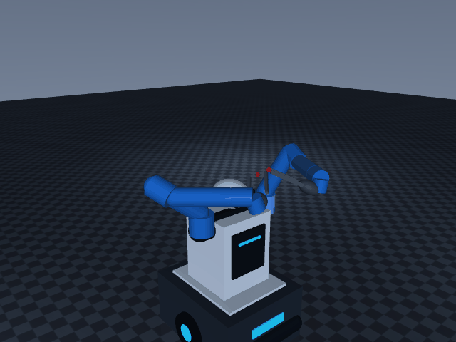

<div align="center">

# 🤖 Dual-Arm Mobile Manipulator for MuJoCo

**A dual-arm mobile manipulation platform based on MuJoCo, Gymnasium, and Mink**

[](LICENSE)
[](https://www.python.org/downloads/)
[](https://mujoco.org/)

English | [简体中文](README.md)

</div>

---

## ✨ Features

- 🎯 **Ready-to-use MJCF Model** - Complete public dual-arm mobile robot model
- 🔧 **Configuration-driven Architecture** - Parameterized robot adapter, easy to swap robots
- 🎮 **Model-driven IK** - Mink-based position/orientation inverse kinematics solver
- 🏋️ **Gymnasium Environments** - Standardized RL training environments (Reach & Pick-Place)
- 📹 **Complete Data Pipeline** - GIF recording, RGB-D-Seg export, LeRobot v2.1 conversion
- 🔀 **Domain Randomization** - Friction and joint damping randomization support
- 🤖 **ML Training Ready** - PPO, BC, Diffusion Policy examples with pretrained model support

---

## 🎬 Demos

<table>
  <tr>
    <td width="50%" align="center">
      <b>Full Workspace View</b><br/>
      <sub>Robot picks objects from left crate, moves base, places into right crate</sub><br/><br/>
      
    </td>
    <td width="50%" align="center">
      <b>TCP-Following Closeup</b><br/>
      <sub>Camera follows left arm end-effector, showing grasp and place</sub><br/><br/>
      
    </td>
  </tr>
  <tr>
    <td width="50%" align="center">
      <b>Dual-Arm Reaching Environment</b><br/>
      <sub>Periodic dual-arm reaching motions in Gym environment</sub><br/><br/>
      
    </td>
    <td width="50%" align="center">
      <b>Spatial Fusion Experiment</b><br/>
      <sub>Comparison of four non-learning depth-prior baselines</sub><br/><br/>
      <a href="recordings/showcase_public/spatial_fusion.mp4">📹 Watch Video</a>
    </td>
  </tr>
</table>

> **📦 Dataset Download**: Full dataset (~192 MB) available in [Dataset Download Guide](docs/DATASET_DOWNLOAD.md)

---

## 🚀 Quick Start

### Install Dependencies

```bash
conda create -n dual-arm python=3.10 -y
conda activate dual-arm
pip install -r requirements.txt
```

### Run Examples

```bash
# Basic demo
python examples/basic_demo.py

# Dual-arm reaching environment
python backend/gym_env_reach.py

# Run tests
python -m pytest
```

### View Model

```bash
# View robot only (default)
mjpython tools/view_robot.py

# View full scene (with table and crates)
mjpython tools/view_robot.py --scene

# Linux / Windows
python tools/view_robot.py --scene
```

> 💡 This entry reads `robot_config.yaml`, initializes both arms to a mirrored chest rest pose, and syncs position actuators. Use `--scene` to load the full workspace with table and crates.

---

## 📋 Feature List

| Feature | Entry | Status |
|---|---|:---:|
| Public dual-arm mobile robot MJCF | [`robot/dual_arm_robot.xml`](robot/dual_arm_robot.xml) | ✅ |
| Configuration-driven robot adapter | [`backend/robot_adapter.py`](backend/robot_adapter.py) | ✅ |
| Mink single-arm position/orientation IK | [`backend/ik_backend.py`](backend/ik_backend.py) | ✅ |
| Two-object pick, carry, place demo | [`backend/public_demo.py`](backend/public_demo.py) | ✅ |
| Dual-arm reaching Gym environment | [`backend/gym_env_reach.py`](backend/gym_env_reach.py) | ✅ |
| Pick-place Gym environment + three RGB views | [`backend/gym_env.py`](backend/gym_env.py) | ✅ |
| Friction and joint damping randomization | `domain_randomization=True` | ✅ |
| qpos trajectory to LeRobot v2.1 | [`backend/serialize_to_lerobot.py`](backend/serialize_to_lerobot.py) | ✅ |
| PPO reinforcement learning training | [`examples/train_ppo.py`](examples/train_ppo.py) | ✅ |
| Behavior cloning (BC) training | [`examples/train_bc.py`](examples/train_bc.py) | ✅ |
| LeRobot pretrained model integration | [`examples/train_with_lerobot.py`](examples/train_with_lerobot.py) | ✅ |
| VR/controller teleoperation | — | 🚧 |
| Depth and segmentation recording | — | 🚧 |

> 💡 **Note**: The public pick-place demo uses IK and smooth interpolation, carrying objects kinematically. It validates kinematics, cameras, and recording pipeline; it is not a contact-rich grasping benchmark.

---

## 📹 Recording Commands

macOS MuJoCo offscreen rendering requires `mjpython`:

```bash
# Generate demo GIFs
mjpython tools/record_demo.py
mjpython tools/record_demo.py --items kebike_0 --seed 42 --fps 20

# Record Gym environment
mjpython tools/record_gym_episode.py --steps 100 --fps 25
```

> 💡 **Tip**: SKUs spawn randomly above the source bin and settle under gravity by default. Use `--seed` for reproducible layout, `--no-rand` for authored XML poses. Linux can directly use `python` instead of `mjpython`.

---

## 🔧 IK Solver

### Does IK require a robot-specific URDF?

IK requires a **concrete kinematic model**, but `MinkIKSolver` does not depend on a vendor-specific URDF and does not hard-code joint names or DOF count:

```text
URDF (optional) ─┐
                 ├─> MuJoCo MjModel + robot_config.yaml
Authored MJCF ──┘            │
                            ▼
            RobotKinematics -> MinkIKSolver
```

**To swap robots, provide**:
- ✅ A loadable MJCF for MuJoCo
- ✅ Configure joints, TCP sites, grippers, base in `robot_config.yaml`
- ✅ Camera mounts and object assets in the scene

> 💡 `MinkIKSolver` automatically discovers and pins non-target joints. The configured base participates only when `allow_base_motion=True` is explicitly requested.

### Minimal IK Example

```python
import mujoco
from backend.ik_backend import MinkIKSolver, kinematics_from_adapter
from backend.robot_adapter import load_default_adapter

adapter = load_default_adapter()
model = mujoco.MjModel.from_xml_path(adapter.get_asset_path("scene"))
data = mujoco.MjData(model)
mujoco.mj_forward(model, data)

solver = MinkIKSolver(model, kinematics_from_adapter(adapter, "left"))
qpos_target, error = solver.solve(data, [1.1, 0.3, 1.1])
```

---

## 🏋️ Gym and LeRobot

### Gym Environment Usage

```python
from backend.gym_env import DualArmPickPlaceEnv

env = DualArmPickPlaceEnv(
    reward_type="shaped",
    camera_obs=True,
    domain_randomization=True,
)
obs, info = env.reset(seed=42)
obs, reward, terminated, truncated, info = env.step(env.action_space.sample())
env.close()
```

### LeRobot v2.1 Conversion

The LeRobot converter reads trajectories and annotations, replays three RGB cameras, and writes Parquet, MP4, and v2.1 metadata:

```bash
pip install pandas pyarrow "imageio[ffmpeg]"
mjpython backend/serialize_to_lerobot.py --src exports --out data/lerobot --fps 10
```

> ⚠️ **Note**: Trajectory width must match the scene's `model.nq`. This repository provides the converter; teleoperation collector is not included.

---

## 🤖 Machine Learning Training

Ready-to-use training scripts for reinforcement learning and imitation learning.

### Quick Start

```bash
# Install training dependencies
pip install -r requirements-training.txt

# Train PPO from scratch
python examples/train_ppo.py --train --timesteps 1000000

# Or train with behavior cloning
python examples/collect_expert_data.py --episodes 500
python examples/train_bc.py --train --data data/expert_demos.npz

# Use LeRobot pretrained models
python examples/train_with_lerobot.py --list
```

**📖 Full training guide**: See [`examples/README.md`](examples/README.md) for detailed tutorials on:
- PPO reinforcement learning
- Behavior cloning (BC)
- Diffusion Policy with LeRobot
- Using pretrained models (ACT, Diffusion, etc.)
- Data collection and augmentation strategies

---

## 📦 Public Dataset

> **Note**: Dataset files are large and not included in the code repository. Obtain them via:
> - **GitHub Releases**: [Download dataset archive](../../releases) (recommended)
> - **Self-generate**: Run commands in `SHOWCASE_RELEASE.md`
> - **Full Guide**: [Dataset Download Guide](docs/DATASET_DOWNLOAD.md)

### LeRobot v2.1 Format Dataset

<details>
<summary><b>📊 Dataset Details</b> (Click to expand)</summary>

**Path**: `recordings/showcase_public/lerobot/`  
**Size**: ~4.6 MB

**Contents**:
- 🗂️ **Parquet data table**: 488 frames of joint states, gripper positions, TCP states, and actions
- 📹 **Three camera videos** (10 fps, 480×640):
  - `observation.image.top`: Top-down workspace view
  - `observation.image.left_wrist`: Left arm wrist camera
  - `observation.image.right_wrist`: Right arm wrist camera
- 📋 **Metadata**: Feature dimensions, data types, episode info

**Feature Description**:
- `observation.state.joint`: 14 joint positions (7 per arm)
- `observation.gripper_position`: 2 gripper openings
- `observation.state.end`: 12-dim TCP pose (6 per arm: xyz + euler angles)
- `actions`: 16-dim next action (14 joints + 2 grippers)

</details>

### Raw Export Data

<details>
<summary><b>🔬 Raw Data Details</b> (Click to expand)</summary>

**Path**: `recordings/showcase_public/exports/episode_000000/`  
**Size**: ~187 MB

**Contains 488 frames of complete sensor data**:
- 🖼️ **RGB images** (`.npy`): Raw RGB arrays from three cameras
- 📏 **Depth maps** (`.npy`): Metric depth values
- 🎨 **Segmentation masks** (`.npy`): Integer label maps
- ☁️ **Point clouds** (`.xyz`): World-space points from top camera
- 🖼️ **Visualizations** (`.png`): RGB, depth, and segmentation previews
- 📈 **Trajectories**: `trajectory_qpos.npy` and `annotation.json`

> 📝 **Data Collection**: Objects spawn randomly above the source bin, settle under gravity, then recording begins. Initial state saved in `initial_qpos.npy`.

</details>

---

## 📂 Project Structure

```text
BimanBot/
├── 🤖 robot/              Public URDF, MJCF, and robot_config.yaml
├── 🎬 scene/              Crates, objects, and combined scenes
├── ⚙️  backend/
│   ├── ik_backend.py      Robot-agnostic Mink IK
│   ├── public_demo.py     Recordable public pick-place demo
│   ├── gym_env*.py        Reach and pick-place Gym environments
│   └── camera_config.py   Configuration-driven three-camera injection
├── 🛠️  tools/
│   └── record_*.py        GIF recording scripts
└── ✅ tests/              Public pipeline regression tests
```

---

## 📄 License

This project is licensed under the [MIT License](LICENSE).

---

<div align="center">

**⭐ Star this repo if it helps you!**

[Submit Issue](../../issues) · [View Docs](docs/) · [Join Discussion](../../discussions)

</div>
> - **Generate yourself**: Run commands in `SHOWCASE_RELEASE.md` to generate data

### LeRobot v2.1 Format Dataset
**Path**: `recordings/showcase_public/lerobot/`  
**Size**: ~4.6 MB

Contains:
- **Parquet data table**: 488 frames of joint states, gripper positions, TCP states, and actions
- **Three camera videos** (10 fps, 480×640):
  - `observation.image.top`: top-down workspace view
  - `observation.image.left_wrist`: left wrist camera
  - `observation.image.right_wrist`: right wrist camera
- **Metadata**: feature dimensions, data types, split information, etc.

Features:
- `observation.state.joint`: 14 joint positions (7 per arm)
- `observation.gripper_position`: 2 gripper openings
- `observation.state.end`: 12-dim TCP pose (6 per arm: xyz + Euler angles)
- `actions`: 16-dim next-step actions (14 joints + 2 grippers)

### Raw Export Data
**Path**: `recordings/showcase_public/exports/episode_000000/`  
**Size**: ~187 MB

Contains 488 frames of full sensor data:
- **RGB images** (`.npy`): raw RGB arrays from three cameras
- **Depth maps** (`.npy`): metric depth values in meters
- **Segmentation masks** (`.npy`): integer label maps
- **Point clouds** (`.xyz`): world-frame XYZ points back-projected from top camera
- **Visualizations** (`.png`): PNG previews of RGB, depth, and segmentation
- **Trajectory**: `trajectory_qpos.npy` and `annotation.json`

Data collection note: Objects are randomly dropped into the source crate, settle under gravity, and then recording begins. The initial state is saved in `initial_qpos.npy`.

## Layout

```text
robot/                   public URDF, MJCF, and robot_config.yaml
scene/                   crates, objects, and combined scene
backend/ik_backend.py    model-driven Mink IK
backend/public_demo.py   recordable public pick-place demo
backend/gym_env*.py      reaching and pick-place Gym environments
backend/camera_config.py config-driven three-camera injection
tools/record_*.py        GIF recording tools
tests/                   public pipeline regression tests
```

## License

[MIT](LICENSE)
